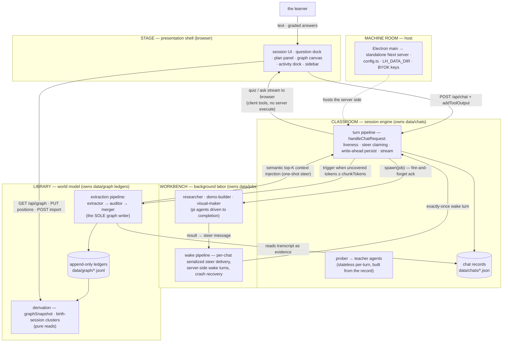

# learning-harness

A standalone learning app (web + Electron desktop): a **teacher agent** (Next.js; the Vercel AI SDK's `UIMessage` protocol end-to-end, LLM engine [pi-ai](docs/pi-engine-swap.md) via OpenRouter), probe→teach lessons with graded quiz/ask interactions, a formal **session plan tree** the teacher authors once (`plan_init`) and whose progress is derived from tagged quiz calls, and a persistent cross-session **knowledge graph** of what the learner knows — the graph is the app's home page.

Not a chat app with a graph bolted on: sessions are probe→teach lessons, the plan tree is a structured, schema-validated object, quiz outcomes reach the graph through the extraction pipeline as ledger events, and the graph feeds back as the teacher's session context (semantic top-K under a token budget) so probing compounds across sessions.

- [`docs/architecture.md`](docs/architecture.md) is the **canonical architecture spec** — layers, the import law, the five systems, the invariants, the seam directory. (The pre-audit spec is archived under `docs/archive/` — history only.)
- Living design doc (all decisions): [`docs/vision.md`](docs/vision.md)
- Build plan + wave/gate results: [`docs/plan.md`](docs/plan.md)

## Commands

```bash
npm install          # once

npm run dev          # http://localhost:3000
npm run build        # production build (standalone output)
npm start            # serve the production build

npm test             # all 44 suites (node:test via tsx; deterministic, no LLM)
npm run lint         # eslint — includes the import law (architecture §2)
npm run typecheck    # tsc --noEmit

npm run desktop:dev    # next dev + Electron shell pointed at it
npm run desktop:dist   # build + package the desktop app (electron-builder)

# one-shot data scripts (run from the master tree only — data never crosses trees)
npx tsx --env-file=.env.local scripts/import-notes.ts <dir>   # bulk-import notes → graph
npx tsx --env-file=.env.local scripts/backfill-graph.ts       # wipe + re-extract every chat
npx tsx --env-file=.env.local scripts/replay-layout.ts        # re-derive layout from the ledgers
npx tsx scripts/sync-pricing.ts                               # regenerate core/prices.ts tables
```

## Environment (`.env.local`)

Secrets and machine-specific paths only. Model choice and thinking budgets are the user's, not the environment's — BYOK model slots live in **settings** (`models` section: strong/cheap/vision, provider + model id + optional thinking level; per-role and per-chat overrides ride on top). The extraction batch threshold is a settings knob too (`graph.extractionChunkTokens`, default 4096, floor 500).

| Variable | Purpose |
|---|---|
| `OPENROUTER_API_KEY` | required — all LLM calls go through OpenRouter |
| `GOOGLE_SEARCH_API_KEY` + `GOOGLE_CSE_ID` | researcher's `web_search` (Google Custom Search) |
| `DEEPGRAM_API_KEY` | optional — dictation (STT token minting; audio streams browser→Deepgram, never through the server) |
| `CHROME_PATH` | optional explicit Chrome path for headless verification (puppeteer-core uses system Chrome; nothing is downloaded) |

The packaged desktop app takes keys from `userData/auth.json` (BYOK, mode 0600, injected into the server child as env only).

## Architecture

Five layers, dependency arrows pointing inward only, machine-enforced as four ESLint zones (shell → barrels only; core and agent never import below themselves). Two composition roots, one writer per store. The full spec — layers, systems, runtime flows, invariants, seams: [`docs/architecture.md`](docs/architecture.md).



**Core invariant:** the extraction pipeline (extractor → auditor → merger) is the sole graph writer — tree-blind and post-hoc, triggered by token coverage, not quiz counts. The LLM stages propose, verify, and judge identity (link-or-create against the current graph; each finding carries verbatim evidence and message-granular provenance); the deterministic merger owns every ledger append and rebuilds anything the model could silently mis-copy (event kinds, timestamps, idempotency refs, provenance) from the transcript. Every node is an objective, world-facing fact; the learner's relationship to it lives entirely in the event ledger. The teacher stays a teacher; everything below the ledgers is derived.

## Layout

```
app/                            Next.js App Router — pages + 16 thin API route handlers
components/                     session + home UI, question dock, plan panel, graph
                                canvas + view, artifact renderers (registry: artifacts/),
                                dictation, activity dock, keyboard machine
src/
  agent/
    system-prompt.md            base teaching behavior (the methodology)
    prompts/{prober,teacher}/   composed numbered fragments per role
    teacher-agent.ts            prober/teacher factories (engine injectable for tests)
    tools.ts                    tool composition; quiz / ask_user_question (client tools)
    tools/plan.ts               plan_init (author-once mermaid plan, deterministic parser)
    tools/probe.ts              probe_done (probe→teach handoff seam)
    tools/jobs.ts               research / demo / visual tool surfaces
    tools/web.ts                web_search (Google CSE) + web_fetch (researcher only)
    subagents/                  researcher · demo-builder · visual-maker
                                · pdf-reader,
                                extraction pipeline (extractor/auditor + merger handoff),
                                runner (async protocol), headless Chrome helper,
                                abort registry
  server/chat-handler.ts       THE turn composition root (liveness · steers · persist · stream)
  server/turn-service.ts       turn seams: persist · extraction trigger
  server/jobs.ts               the wake pipeline: serialized per-chat steer delivery,
                               server-side wake turns, crash recovery
  server/stores.ts              THE storage composition root — the one place adapters wire in
  server/turn-liveness.ts       per-chat turn registry (one turn per chat, ever)
  server/observability.ts       the activity feed (running jobs + extraction, abort)
  server/pi/                    the engine bridge: record-adapter (record → pi messages)
                                · ui-stream (pi events → UIMessage SSE)
  server/index.ts               the server barrel (the only server import app/ may use)
  core/contracts/{plan,graph,chat,jobs,probe,models}.ts
                                the contracts — one file per domain
  core/ports.ts                 storage ports — ChatStore · GraphStore · JobStore
                                (core code depends on these types only)
  core/                         question-core, plan-tree, phases, pending, graph
                                (merger/derivation), coverage, layout, clusters,
                                prices, tool-parts — all pure: storage
                                arrives as parameters
  store/                        fs adapters implementing the ports: chats · graph
                                ledgers · jobs (+ render-settings, default-settings)
electron/                       desktop launcher + security guard (spawns the standalone
                                server; 1 IPC channel; LH_DATA_DIR + BYOK env)
scripts/                        build-server.mjs (packaging guards), import-notes,
                                backfill-graph, replay-layout, sync-pricing
data/                           chats/ · graph/ (six ledgers + positions/sources/
                                render-settings maps) · jobs/ · settings.json —
                                runtime state, git-ignored
```

## Key mechanisms

**Client-side question tools.** `quiz` and `ask_user_question` have no server `execute`: the tool call streams to the browser, the learner answers in the dock, the client grades via `question-core` and returns the verdict with `addToolOutput` — which fires the SDK continuation so the teacher resumes mid-turn. Options are shuffled deterministically (seeded by toolCallId) so server and client renders match. A pending quiz persisted in the chat record is exactly what makes **resume mid-question free**.

**The formal plan tree (author-once).** The teacher authors the session's dependency tree with one schema-validated tool — `plan_init`, whose mermaid-subset input is parsed deterministically (line-numbered errors) and validated as a DAG. The tree persists in the chat record; progress is never mutated — `current`/`visited`/upcoming are **derived** from tagged quiz calls in the transcript, and the panel renders that derivation.

**The async sub-agent protocol (ack-and-steer).** `research` / `demo` / `visual` are server-executed tools: the call resolves immediately mid-turn with a fire-and-forget ack and the teacher keeps teaching; a background runner works in parallel (the client polls `/api/activity` and `/api/jobs`). On completion the runner builds a **steer message** — a user-role `UIMessage` whose text part is the model-facing result and whose `data-subagent-artifact` part carries the full result for the client — and the **wake pipeline** delivers it: a per-chat serialized queue waits for the turn to end and no question to be pending, then fires a server-side teacher turn that weaves the result into the lesson. Delivery is exactly-once (deterministic steer ids, delivered-flag checks at every claim point); stalled jobs are recovered on read; aborted jobs deliver an abort steer. The client adopts the wake turn through the same `turnInFlight` machinery as returning mid-stream (busy shimmer, composer gate) and renders steers as artifacts — never a bubble. Sub-agents **verify, never one-shot**: the demo-builder headlessly executes its HTML in system Chrome before delivery; the visual-maker renders each SVG and looks at it (vision-capable model — the `vision` slot in settings).

**The knowledge graph (two channels, one writer).** The write channel: the extraction pipeline — extractor (LLM: sees only the session, rendered as readable markdown by the shared `core/session-markdown.ts` engine — propositions as true statements, `follows`/`supports` edges with verbatim evidence; fully trusted, graph-blind) → auditor (LLM, an agentic loop that never sees the source: explores the existing graph through `find` / `list_sessions` / `list_propositions` tools, stamps each proposition with an identity verdict — link to an existing node (equivalence bias: paraphrases merge) or create — and may draw bridging edges between existing nodes and the new batch) → merger (`mergeFindings`, deterministic: applies the verdicts, link-appends phrasings/provenance, resolves and dedupes edges, checkpoints coverage) → layout settle. No quiz outcomes or understanding assessments live in the graph (2026-09-27 cleanup); practice (`/practice`) consumes the graph as feedback-only problem sets and writes nothing back. Triggered when a chat's **uncovered tokens** (message-view fingerprints, `coverage.jsonl`) cross `graph.extractionChunkTokens` (a settings knob, default 4096, floor 500 — read fresh per turn); failure checkpoints nothing, the next trigger re-runs. The same pipeline serves the **notes front door** (`POST /api/graph/import`: any `*.md`/`*.txt` becomes a source; re-imports are idempotent by path hash). The read channel: `GET /api/graph` derives the snapshot from the ledgers — a pure read; the home view is a hand-rolled Canvas 2D renderer (one rAF loop, dirty-flag idle, d3-zoom camera, zoom-gated labels, cluster hulls) over a d3-force layout, with server-persisted render settings and drag-committed positions. Clusters are **birth-session groupings**: a node joins the cluster of the session that birthed it (a chat, or an imported notes file as a file-kind session), derived at read — no embedding pass, no naming pass. The teacher reaches the graph on its own terms through the gated prober tools (`list_sessions` / `list_propositions`, the `agent.graphTools` setting) — there is no automatic context injection.

**Practice (problem sets).** The graph's `follows`-edges become reasoning chains; the `/practice` creation dialog picks a birth-session cluster (the graph view's own groups) and freezes its propositions + chains into a self-contained `ProblemSet`. Three named-level axes steer generation (ladder rung 0–4, cue distance 0–2, Theory|Application — never a number to interpolate; defaults Direct exercise · Adjacent context · Theory), plus an optional free-form note the agents weigh but need not follow. Creation has two entries: the cluster picker on `/practice`, or the graph view's chain table — a full-bleed sortable table of every reasoning chain, grouped by birth cluster, selecting chips, chains, or whole clusters, whose floating selection bar shows the exact `N propositions → M chains` the agents will receive — handing a free-form node selection to the same dialog. A partitioner agent covers every chain exactly once, one generator per partition writes problems against the owner's problem-engineering framework (commit-before-pose: statement + solution + rubric together), and grading is **strengthening, not assessment** — one attempt per problem with its own submit button, instant solution/rubric reveal, then a score 0–10 with brief reasoning landing live; nothing ever written back to the graph. Runs are registry-backed background jobs on the activity dock (no steer, never wakes the teacher); sets live in `data/practice`, crash-swept on boot.

**Dictation.** Optional speech-to-text: the server mints short-lived Deepgram tokens; audio streams browser→Deepgram over WebSocket, never through the server.

## Testing

All deterministic, no LLM, no network (engines are injected — pi-ai's faux provider scripted per test; `globalThis.fetch` stubbed where transport matters):

1. **Pure core units** — merger (via the real fs adapters, backup-and-restored), derivation, coverage, question grading, plan tree, phases, clusters, layout, tool-parts, prices.
2. **Server flows** — `handleChatRequest` driven end-to-end with scripted engines: persistence, liveness, steer claiming, the wake pipeline (409 retry, quiz deferral, idempotency), crash recovery, the data-dir seam (including a fresh child process).
3. **Sub-agent loops** — researcher/demo-builder/visual-maker with fake headless APIs; the extraction pipeline end-to-end (audit drops, failure-checkpoints-nothing, single-flight, abort).
4. **Render tests** — transcript, cards, docks, composer, sidebar, coverage via React server-side rendering.

## Lineage

The teaching methodology comes from the Obsidian-based POC (`~/Desktop/Obsidian/vault/π/learn`; its `knowledge graph design.md` was the original epistemic-model source, since amended — see the amendments table in `docs/vision.md`). The harness was originally built on the pi agent SDK, pivoted to standalone Next.js + the Vercel AI SDK, and later swapped its LLM engine back to pi-ai while keeping the AI SDK's `UIMessage` as the client protocol ([`docs/pi-engine-swap.md`](docs/pi-engine-swap.md)).

## Data

Nothing under `data/` is ever tracked by git. Chats, graph ledgers, jobs, positions, and the settings records are plain files (JSON/JSONL) — inspect them freely; they are the canonical records. The desktop app relocates the whole directory via `LH_DATA_DIR`.