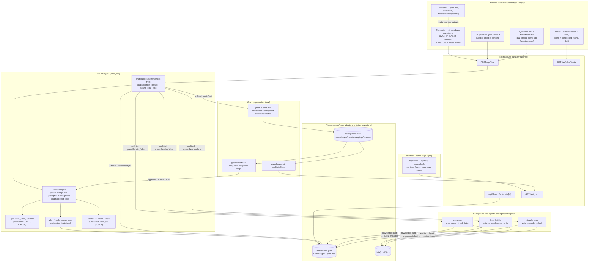

# learning-harness

A standalone learning harness: a **teacher agent** (Next.js + Vercel AI SDK, models via OpenRouter), graded quiz/ask interactions, a formal **session plan tree** the teacher authors and edits live, and a persistent cross-session **knowledge graph** of what the learner knows — the graph is the app's home page.

Not a chat app with a graph bolted on: sessions are probe→teach lessons, the plan tree is a structured, agent-editable object, quiz outcomes feed the graph as ledger events, and the graph feeds back as the teacher's context so probing compounds across sessions.

- Living design doc (all decisions): [`docs/vision.md`](docs/vision.md)
- Build plan + wave/gate results: [`docs/plan.md`](docs/plan.md)
- [`docs/architecture.md`](docs/architecture.md) is the **pre-pivot v0 scaffold** (pi-based, Fastify/Vite) — kept as history only; everything current is below.

## Commands

```bash
npm install          # once

npm run dev          # http://localhost:3000
npm run build        # production build
npm start            # serve the production build

npm test             # all tests (node:test via tsx; deterministic, no LLM)
npm run typecheck    # tsc --noEmit

npx tsx scripts/bench-graph.ts   # force-layout benchmark (synthetic graphs)
```

## Environment (`.env.local`)

| Variable | Purpose |
|---|---|
| `OPENROUTER_API_KEY` | required — all LLM calls go through OpenRouter |
| `LH_MODEL` | teacher model (default `anthropic/claude-sonnet-4.5`) |
| `LH_RESEARCH_MODEL`, `LH_DEMO_MODEL` | per-sub-agent overrides (fall back to `LH_MODEL`) |
| `LH_VISUAL_MODEL` | visual-maker model — must be **vision-capable** (it looks at rendered SVGs) |
| `GOOGLE_SEARCH_API_KEY` + `GOOGLE_CSE_ID` | researcher's `web_search` (Google Custom Search) |
| `CHROME_PATH` | optional explicit Chrome path for headless verification (puppeteer-core uses system Chrome; nothing is downloaded) |

## Architecture



**Core invariant, carried over from the original design:** the graph is never asserted by an LLM post-hoc guesswork — v1 emission is deterministic code over structured tool data. The teacher stays a teacher; everything below the ledgers is derived.

## Layout

```
app/                            Next.js App Router (UI + API route handlers)
components/                     session + home UI, question dock, tree panel,
                                graph view, artifact renderers (registry: artifacts/)
src/
  agent/
    system-prompt.md            base teacher behavior (the teach methodology)
    prompts/*.md                composed fragments (plan tree, jobs, phases,
                                demos, graph context) — one per workstream
    teacher-agent.ts            ToolLoopAgent bootstrap (model injectable for tests)
    tools.ts                    per-request tool registry
    tools/plan.ts               plan_init / add_node / … / set_current / mark_done
    tools/web.ts                web_search (Google CSE) + web_fetch (Readability)
    tools/jobs.ts               research / demo / visual tool surfaces
    subagents/                  researcher · demo-builder · visual-maker,
                                runner (async protocol), headless Chrome helper
  server/chat-handler.ts       one chat turn: stream, persist, spawn, emit
  server/stores.ts              THE composition root — the one place adapters wire in
  core/contracts.ts             THE contracts file — types + protocol docs
  core/ports.ts                 storage ports — ChatStore · GraphStore · JobStore
                                (core code depends on these types only)
  core/                         question-core, plan-tree, phases, pending,
                                graph (emission/derivation), graph-context, math delims
                                — all pure: storage arrives as parameters
  store/                        fs adapters implementing the ports: chats ·
                                graph ledgers · jobs (plain fs, no framework)
scripts/bench-graph.ts          sigma/forceAtlas2 layout benchmark
data/                           chats/ · graph/ · jobs/ — runtime state, git-ignored
```

## Key mechanisms

**Client-side question tools.** `quiz` and `ask_user_question` have no server `execute`: the tool call streams to the browser in `input-available` state, the learner answers in the dock, the client grades via `question-core` and returns the verdict with `addToolOutput` — which fires the SDK continuation so the teacher resumes mid-turn. A pending quiz part persisted in the chat record is exactly what makes **resume mid-question free**.

**The formal plan tree.** The teacher authors the session's dependency tree with schema-validated tools (`plan_init`, `plan_add_node`, … `plan_set_current`, `plan_mark_done`). The tree persists in the chat record; the tree panel renders from the latest plan tool output in the transcript. Quiz calls can tag a `nodeId`, so outcomes feed the graph per-node.

**The async sub-agent protocol.** `research` / `demo` / `visual` are also client-side tools: the server turn ends at the call, `onFinish` spawns a background runner (fire-and-forget), the job store tracks a live activity line, the client polls `/api/jobs` while parts are pending, and on completion the runner rewrites the tool part in the chat record to `output-available` — the client re-syncs, the continuation fires, the teacher receives the result as a normal tool output. Sub-agents **verify, never one-shot**: the demo-builder headlessly executes its HTML in system Chrome before delivery; the visual-maker renders each SVG and looks at it (needs a vision-capable `LH_VISUAL_MODEL`).

**The live graph.** Every completed turn folds the chat into append-only JSONL ledgers (`emitChat`: tree nodes/edges, quiz outcome events, taught events — idempotent, checkpointed, so partial sessions still deposit value). The home view derives node states from the ledgers and lays them out with forceAtlas2 (run-then-freeze — no idle simulation). At session start the derived graph is rendered into a compact markdown block appended to the teacher's instructions (`buildGraphContext`) — whole graph while small, hotspots + 1-hop neighborhood past 150 nodes.

## Testing

All deterministic, no LLM (models are injected as `MockLanguageModelV4` where an agent loop is under test):

1. **Pure core units** — plan-tree ops, question grading, phases, graph emission, graph-context selection, math delimiters.
2. **Server flows** — `chat-handler` driven directly with a scripted mock model: persistence, job spawning, part rewriting, continuation.
3. **Sub-agent loops** — researcher/demo-builder/visual-maker with mock models + fake headless API.
4. **Render tests** — transcript, cards, dock, composer, tree panel via React server-side rendering.

## Lineage

The teaching methodology comes from the Obsidian-based POC (`~/Desktop/Obsidian/vault/π/learn`; its `knowledge graph design.md` is still canonical for the epistemic model). The harness was originally built on the pi agent SDK, then pivoted to standalone Next.js + Vercel AI SDK (see the amendments table in `docs/vision.md`).

## Data

Nothing under `data/` is ever tracked by git. Chats, graph ledgers, and jobs are plain files (JSON/JSONL) — inspect them freely; they are the canonical records.
