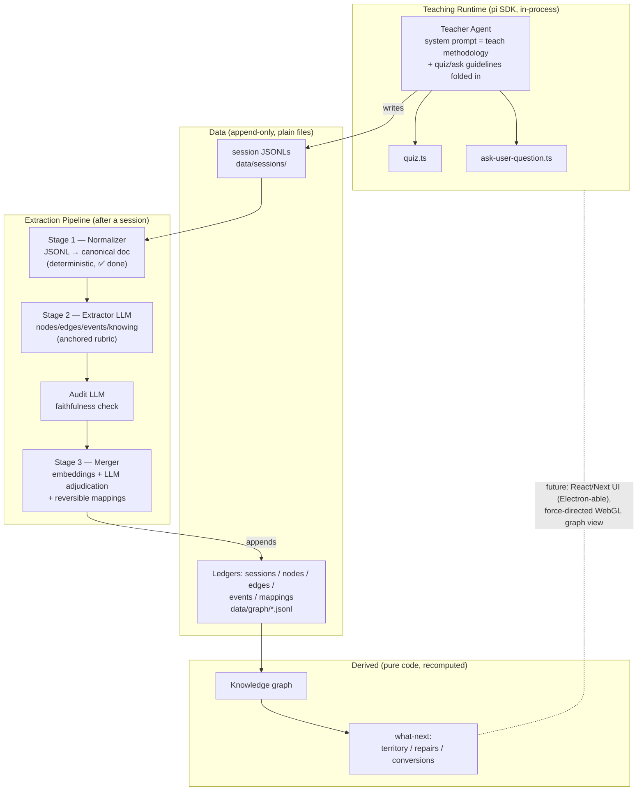

# Learning Harness — Architecture

Status: v0 scaffold. Teacher runtime ✅ · data model + ledgers ✅ · normalizer ✅ · extractor / merger / derived views — specified, not yet implemented.

## What this is

A standalone learning harness built **on top of** pi (`@earendil-works/pi-coding-agent`) as a library dependency — the same relationship as building an app on Express. It is **not** the user's global pi: hermetic isolation, own pinned version, own sessions, own system prompt.

Built up from the Obsidian-based POC (`~/Desktop/Obsidian/vault/π/learn`) — the teaching behavior is identical (same teach methodology, same quiz tool, same probe → plan → teach flow), but the interface and data pipeline are the harness's own. Full design reasoning lives in the POC's `knowledge graph design.md`; this doc covers what's implemented here.

## Architecture

**Core invariant:** LLMs only ever touch the top pipeline (semantic judgment). Everything below the ledgers is deterministic code. The teacher stays a pure teacher; the graph is never asserted by an LLM — only by logged, reversible evidence.

## Teacher runtime

`src/teacher/create-session.ts` boots pi via the SDK with total isolation:

| Concern | Value |
|---|---|
| System prompt | `teacher/system-prompt.md` — the teach methodology (from the POC's teach skill) with the quiz + ask_user_question usage guidelines folded in (custom prompts drop extension guidelines — verified in pi's `buildSystemPrompt`) |
| Tools | `noTools: "builtin"` → no read/bash/edit/write; only `quiz` + `ask_user_question` |
| Extensions | explicitly via `additionalExtensionPaths`; imports of old `@mariozechner/*` names resolve through pi's loader aliases |
| agentDir | `data/agent/` — hermetic. `auth.json` and `models-store.json` are **symlinks** to `~/.pi/agent/` (credential + catalog sharing only) |
| Sessions | `data/sessions/` via `SessionManager.create(cwd, sessionDir)` |
| Model | from `data/agent/settings.json` (currently openrouter/z-ai/glm-5.3, thinking high) |
| Research tool | deliberately absent in v0 — the system prompt's accuracy rule is adapted accordingly (flag uncertainty, never bluff) |

Run: `npm run teach` → full pi TUI, quiz popups, session persisted in `data/sessions/`.

`npm run doctor` → non-interactive smoke test (verifies extensions, tools, model, prompt; no leaks).

## Data model

`src/schema.ts`. Key decisions:

- **Nodes** are propositions at ~one-reasoning-step grain; `kind: truth | misconception`; `state: known | not-held | candidate`.
- **Edges** carry NO scalars — only `type: requires | supports` and provenance. "Load-bearing" is derived, never stored.
- **Events** are the append-only source of truth: `(node, kind, session, entryId, evidence)`. Every event carries `entryId` → **jump-to-point**: the exact place in the session where it happened. A node's "which sessions is it from" derives from its events (merges union them automatically).
- **Mappings** are merge decisions, logged and reversible.
- **Knowing** is assessed on an anchored ordinal rubric (misconception / absent / shakily-known / known / fluent) — never freehand scalars, never per-session normalized.
- **known ≠ understood**: known is evidence (ledger); understood is structure (derived: known + requires-subtree held). The extractor does zero inference about knowledge.

## Extraction pipeline

1. **Normalize** (`src/extract/normalize.ts`, ✅) — deterministic. Quiz toolResults in the JSONL carry full structured details (question, options, correct/dontKnow, note), so quiz events are read as data, not parsed from prose. Verified against a real POC session.
2. **Extract** (`extract.ts`, stub) — one LLM pass: nodes, edges (primarily from the plan's mermaid DAG, already asserted by the teacher), attributed events, knowing on the rubric. Zero inference beyond evidence.
3. **Audit** (stub) — second LLM call checking extraction faithfulness only.
4. **Merge** (`merge.ts`, stub) — embedding kNN + one adjudication call per session: `same` (alias) / `related` (new node + cross-session edge — the only place cross-domain edges are born) / `unrelated`. Conservative: prefer duplicates over wrong merges. Fully automatic; mappings make every decision reversible.

## Derived views (stubbed)

`src/derive.ts` + `src/queries/what-next.ts` — pure code over the ledgers: known-set now; understanding aggregation **parked** (weakest-link vs mean vs two-level mean/max — confounded with edge typing, to be decided on real extracted data). What-next returns territory / repairs / conversions; unlock-value runs over lazily expanded frontier, discounted by depth in generated territory.

## Build order (from here)

1. ~~repo scaffold, teacher runtime, data model, ledgers, normalizer~~ ✅
2. Extractor + audit (LLM pass, structured output)
3. Merger (embeddings + adjudication)
4. Derive + what-next queries (CLI)
5. Retroactive bootstrap over the POC session JSONLs in `~/.pi/agent/sessions/--Users-amos-Desktop-Obsidian-vault-π-learn--/`
6. *(parked)* React/Next interface, graph rendering (force-directed WebGL, Obsidian-graph feel), spaced repetition, research tool for the teacher
