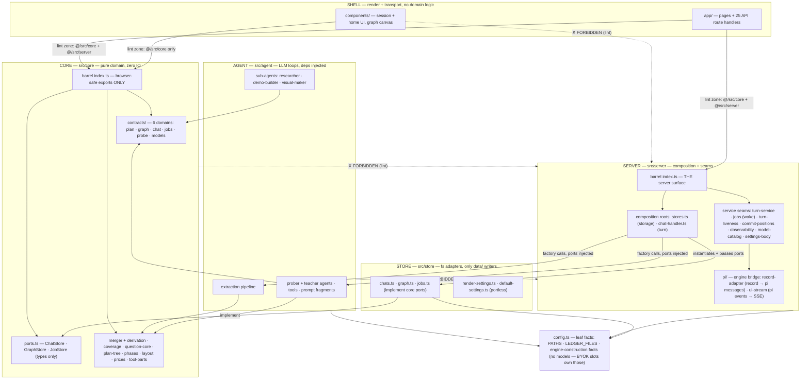
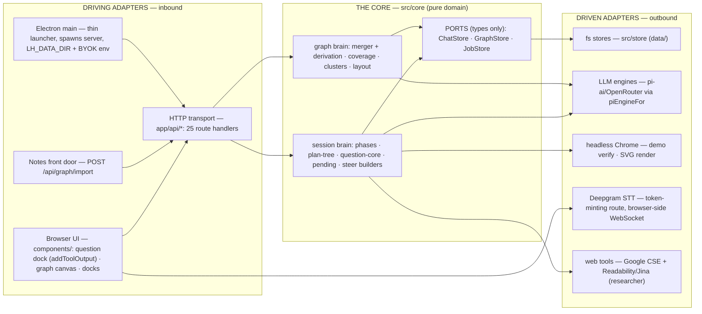
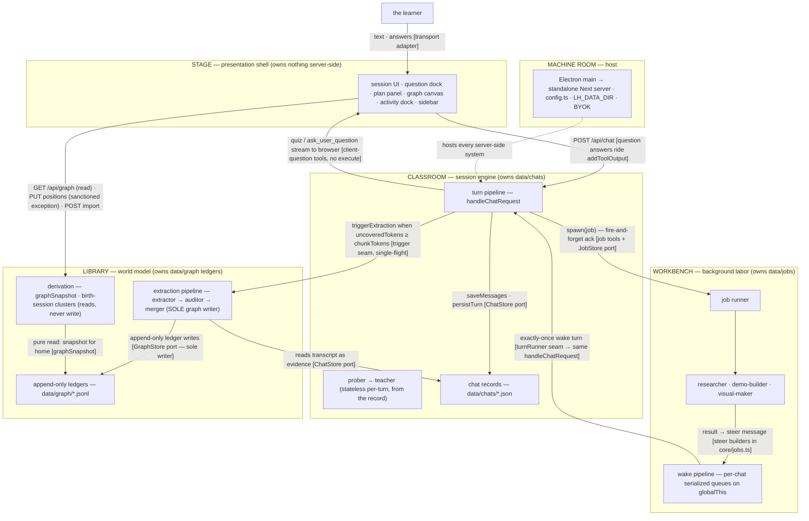
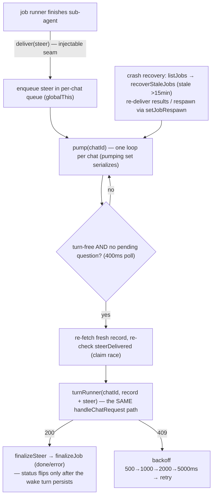
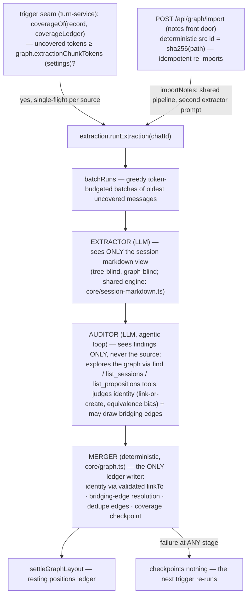
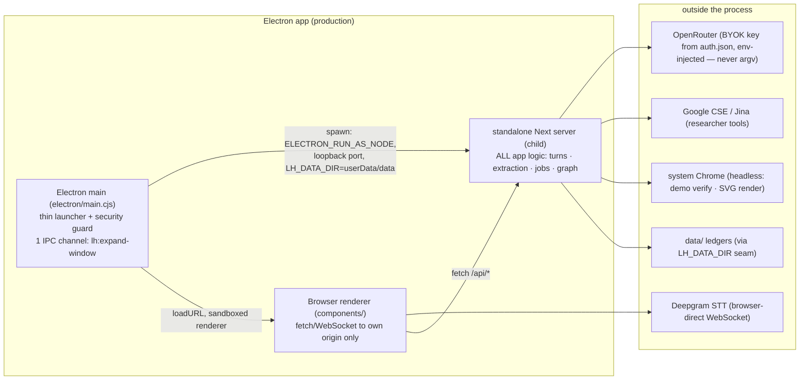

# Learning Harness — Architecture

Status: **the canonical architecture spec** — describes the as-built system, verified against the code by a full audit on 2026-09-18 (every file under `src/`, `app/`, `components/`, `electron/`, `scripts/`, the lint config, and the test suite; `lint` and `typecheck` clean on the audited tree). The pre-audit spec is archived at [`archive/architecture-2026-09-08.md`](archive/architecture-2026-09-08.md) — history only. Product reasoning lives in [`docs/vision.md`](vision.md); file-by-file layout lives in the README.

**What this is.** A standalone learning app (web + Electron desktop): the learner's knowledge accumulates into one persistent, cross-session knowledge graph, built from tutoring sessions in which a teacher agent authors a formal, visible dependency tree (the plan tree) and verifies understanding with structured questions. The graph is the home page; the session is the classroom; everything else serves those two.

**Design principles, in priority order:**

1. **Maximum control.** Every dependency edge is explicit and machine-checked. Nothing reaches sideways for convenience.
2. **Easy editability.** A worker can trace any behavior to one file. Layers are named by responsibility, not by framework accident.
3. **Zero technical debt.** The shape you see is the shape that runs. Deprecated paths are deleted, not parked.
4. **Crystal-clear architecture.** Two barrels as the entire public API, two composition roots, one writer per store, named seams. When a rule can be a lint rule, it is.

**The one-sentence model:** a pure domain core at the center; every external effect (fs, LLMs, browser, OS) behind an adapter at the edge; two composition roots as the only places the edges are plugged together; and every persistent store written by exactly one system.

---

## 1. Two axes, one law

Hold the architecture along two orthogonal axes:

**Static structure — the hexagon.** One pure core (`src/core`); everything else is an *adapter* (implements a core port or drives the core) or a *composition root* (the only code that wires adapters to core). Dependency arrows point **inward only** — toward purity, toward stability. Two barrels are the entire public API: `@/src/core` (browser-safe) and `@/src/server` (the server-side surface).

**Runtime ownership — five systems.** Each persistent store has exactly one owning writer-system; systems talk only through named, idempotent protocols:

| System | Owns (sole writer) | Role |
|---|---|---|
| **Classroom** — session engine | `data/chats/*.json` | the turn pipeline, prober→teacher, plan tree, questions, phases |
| **Workbench** — background labor | `data/jobs/*.json` | job runner, researcher/demo-builder/visual-maker, steer delivery |
| **Library** — world model | `data/graph/*` ledgers | extraction pipeline (sole graph writer), derivation, birth-session clusters |
| **Stage** — presentation shell | nothing server-side | components/, graph canvas, docks — pure consumer via `/api/*` |
| **Machine room** — host | process + config | Electron main, standalone Next server, `config.ts`, data-dir seam, BYOK keys |

**The unifying law** (generates everything else): **imports point inward, writes point to append-only evidence, and everything else is derived.** Dependency flows toward purity; data flows toward evidence; no state is stored where it can be recomputed.

---

## 2. The layers and the import law

Dependency arrows point **down only**. Each layer may import the core barrel; nothing skips a boundary for convenience.

```
┌──────────────────────────────────────────────────────────────┐
│ SHELL      app/            Next.js route handlers (transport) │
│            components/     session + home UI (render only)    │
├──────────────────────────────────────────────────────────────┤
│ SERVER     src/server      composition roots (stores.ts,      │
│            chat-handler.ts) + named service seams + the      │
│            pi engine bridge. Zero business logic              │
├──────────────────────────────────────────────────────────────┤
│ AGENT      src/agent       prober + teacher loops, tool       │
│            surfaces, prompt fragments, sub-agents, the       │
│            extraction pipeline. Deps arrive via factories —  │
│            never imported from below                          │
├──────────────────────────────────────────────────────────────┤
│ CORE       src/core        pure domain: contracts (6 domains),│
│            ports, merger + derivation, coverage, question-   │
│            core, plan-tree, phases, layout, prices. No IO     │
│            (two files use node:crypto — pure                  │
│            but node-bound, hence kept out of the barrel)      │
├──────────────────────────────────────────────────────────────┤
│ STORE      src/store       fs adapters: chats · graph        │
│            ledgers · jobs (implement core ports) + two       │
│            portless settings adapters. The ONLY modules     │
│            that touch data/                                   │
└──────────────────────────────────────────────────────────────┘
```

**The import law** (`eslint.config.mjs` — the config's sole job; four `import/no-restricted-paths` zones, all `"error"`; each verified to fire; `lint` is a gate on every change):

| Zone | May import | Rationale |
|---|---|---|
| `components/**` | `@/src/core` only (the barrel) | The UI renders domain data; it never runs domain logic or touches IO |
| `app/**` | `@/src/core` + `@/src/server` (the barrels) | Route handlers are transport; they delegate to server entry points |
| `src/core/**` | nothing below itself (never `agent`/`server`/`store`) | The core is pure; adapters implement its ports, never the reverse |
| `src/agent/**` | never `server`/`store` | The agent layer receives its dependencies (ports, engines, seams) via factories/closures |



**Two rules are documentation-only by design.** The ESLint plugin's `except` can't express "all but one", so (a) `src/server/stores.ts` is *intended* to be the only server module importing adapters — but the server barrel also re-exports the two portless settings adapters and `observability.ts` imports `chatStore` directly; and (b) the browser-safety of the core barrel is a doc-comment convention (see §2.1). `tests/`, `scripts/`, and `electron/` are deliberately outside the law (lint-excluded); tests import freely across layers, scripts act as extra composition roots.

### 2.1 The core barrel and browser-safety

`src/core/index.ts` exports only browser-safe modules — pure logic + types, no node builtins, no fs, no network. Deliberately **not** barrel-exported (server code imports them directly): `graph.ts` and `coverage.ts` (need `node:crypto`), `clusters.ts`, `session-clusters.ts` and `layout-settle.ts` (server-only roles). Port *types* are types-only, hence safe to re-export. This split is what lets the same core serve browser (grading, layout, plan statuses, cost folding) and server (merger, derivation, coverage).

### 2.2 Contracts — one file per domain

`src/core/contracts.ts` is a barrel over six domain files, each owned outright by its stream (schema changes in a domain you don't own go through the master session):

- `contracts/plan.ts` — plan tree types + derived statuses (`derivePlanStatuses`)
- `contracts/graph.ts` — graph domain: ledgers, findings/audit shapes, snapshot, birth-session clusters
- `contracts/chat.ts` — session records, usage/money channel, settings, handoff text
- `contracts/jobs.ts` — the ack-and-steer protocol: job records, steer message builders, deterministic steer ids, usage accumulation
- `contracts/probe.ts` — probe assessment + the shared zod schema
- `contracts/models.ts` — client-safe model-catalog shapes

---

## 3. Ports, adapters, and the composition roots

Storage is **per-entity semantic ports**, never one generic interface: `ChatStore`, `GraphStore`, `JobStore` (`src/core/ports.ts` — types only). The fs adapters (`src/store/{chats,graph,jobs}.ts`) implement them and contain persistence and nothing else. Two more adapters (`src/store/{render-settings,default-settings}.ts`) are portless free functions re-exported through the server barrel — a deliberate pragmatic bypass, documented here so nobody mistakes it for the pattern.

**Idioms.** Graph evidence lives in **append-only JSONL ledgers** (corrupt-line-tolerant reads; strict shape guards drop invalid lines, never guess). Chats, jobs, positions, sources, and the settings blobs are whole-file read-modify-write JSON. All writes are synchronous, single-process (atomicity rides the Node event loop). Merge/dedup/derivation semantics are **reader-side, in core** — the store never decides.

- **`src/server/stores.ts` is THE composition root for storage**: it instantiates the adapters and hands the port objects to everything else (chat-handler, job runner, extraction pipeline, graph/positions/chats routes, turn services). It is the single place a storage decision (JSON vs SQLite, local vs remote) gets re-made.
- **`src/server/chat-handler.ts` is THE composition root for a turn**: it wires the stores, the job runner, the extraction pipeline, and the pi engine into the stream response (`setTurnRunner`/`setJobRespawn` register its seams for the wake pipeline). All logic lives behind the seams it calls.
- The agent layer is dependency-inverted throughout: `createJobRunner({ chatStore, jobStore, deliver })`, `createExtractionPipeline({ chatStore, graphStore, extractor?, auditor?, embedder })`, `createTeacherTools({ chatId, chatStore, jobStore, spawn })`, `createProberAgent`/`createTeacherAgent(engine?, tools?, …)`. Tests inject the same ports production wires — or swap an in-memory port.

The engine side is adapted too: `src/agent/models.ts` (`piEngineFor`) resolves each role's engine from the user's **model slots** (BYOK: `settings.json` `models` section — strong/cheap/vision — plus per-role/chat overrides; a chain that ends empty refuses honestly with 503 `models_not_configured`), and `src/server/pi/` bridges the two SDK worlds: `record-adapter.ts` (persisted UIMessage record → stateless pi `Message[]`, dangling tool calls get synthesized INTERRUPTED results) and `ui-stream.ts` (pi agent events → AI-SDK UIMessage SSE).



---

## 4. The five systems (runtime ownership and protocols)

The systems view: each box owns its store; edges are the protocols, each with the adapter/seam that implements it.



Three server-side systems, each the sole writer of its own store, connected by exactly three protocols: the **turn request** (Stage→Classroom), the **ack-and-steer** loop (Classroom→Workbench→Classroom), and the **extraction trigger + transcript read** (Classroom→Library). The Stage touches systems only through the thin HTTP transport; the teacher reaches the Library directly through the gated prober tools (`list_sessions` / `list_propositions`) rather than any injected context.

---

## 5. The session (one chat turn)

`handleChatRequest` is framework-free (plain `Request`/`Response`) with a `buildAgent` test seam so tests drive it with scripted engines. The turn, in exact order:

```mermaid
sequenceDiagram
    participant B as Browser (useChat)
    participant R as POST /api/chat
    participant H as handleChatRequest
    participant L as turn-liveness (globalThis)
    participant CS as chatStore adapter
    participant A as prober/teacher agent (pi engine)
    participant F as onFinish seams

    B->>R: messages (+ graded question output via addToolOutput)
    R->>H: handleChatRequest(req)
    H->>L: beginTurn(chatId)
    Note over H,L: already running → 409; retryingFetch waits, re-fetches<br/>the record, merges unsent client messages by id, re-POSTs
    H->>H: claimSteers — coalesce queued steers into outgoing
    H->>CS: saveMessages (write-ahead: persist even before the stream)
    H->>A: build agent from record (probe_done part in transcript ⇒ teacher)
    Note over H,A: recordToPiMessages: stateless rebuild; dangling<br/>tool calls get synthesized INTERRUPTED results
    A-->>B: SSE stream (ui-stream bridge)
    Note over B: quiz / ask_user_question have NO server execute:<br/>rendered in the dock; graded client-side via question-core
    B->>B: QuestionDock: parse → shuffle (seeded) → buildAnswer (grade)
    B->>R: continuation (sendAutomaticallyWhen fires)
    A-->>F: onFinish
    F->>CS: persistTurn (canonical, idempotent) + appendTurnUsage
    F->>F: triggerExtraction — if uncovered tokens ≥ chunkTokens, fire async
    F->>L: endTurn (ALWAYS last — the registry never locks)
```

- **Client-side question tools** (`quiz`, `ask_user_question`) have no server execute: the call streams to the browser, the learner answers in the dock, the client grades via `question-core` and returns the verdict with `addToolOutput`, which fires the continuation. A pending quiz persisted in the record is exactly what makes **resume mid-question free**. Deterministic seeded shuffling (keyed by toolCallId) keeps server and client renders identical.
- **The prober→teacher handoff**: the first turn(s) run the prober (floor/ceiling via quiz, goal via ask); `probe_done` (server-executed) files the assessment and queues a handoff steer; from the first `tool-probe_done` part in the transcript, the handler builds the teacher agent for every later turn. Phases (`core/phases.ts`) fold strictly: probe → plan → teach.
- **The formal plan tree is author-once**: the teacher authors the session's dependency map with a single schema-validated `plan_init` tool (a mermaid-subset graph, parsed deterministically with line-numbered errors, validated as a DAG). Progress is never mutated — statuses (`current`/`visited`/upcoming) are **derived** from tagged quiz calls in the transcript; the tree panel and the plan blocks render that derivation.
- **Job tools are server-executed, ack-and-steer**: `research`/`demo`/`visual` resolve immediately mid-turn with a fire-and-forget ack (the teacher keeps teaching); `spawn(job, input)` fires the background runner.
- Each turn service is a named, error-contained seam taking explicit deps; failures log one `[chat <id>]` line and never touch the response. Swapping any of them touches nothing else.

### 5.1 The wake pipeline (Workbench → Classroom)

On sub-agent completion the runner builds a **steer message** — a user-role `UIMessage` whose text part is the model-facing result and whose `data-subagent-artifact` part carries the full result for the client (provider conversion drops data parts) — and hands it to the wake pipeline:



Job status flips done/error only after the wake turn persists. Delivery is **exactly-once**: deterministic steer ids (`steer_<jobId>`, `steer_probe_<chatId>`), `steerDelivered` checks at every claim point, and `claimSteers` finalizing in-transcript steers instead of re-appending. The client adopts the wake turn through the same `turnInFlight` machinery as returning mid-stream (busy shimmer, composer gate, append-only `mergeAdopted` adoption) and renders steers as artifacts — never a bubble.

Sub-agents **verify, never one-shot**: the demo-builder headlessly executes its HTML in system Chrome before delivery; the visual-maker renders each SVG and looks at it (needs a vision-capable model — the `vision` slot in settings).

---

## 6. The knowledge graph — two channels, one writer

**The extraction pipeline is the sole graph writer.** Nothing else appends to `data/graph/*.jsonl` — not the teacher, not the server, not a migration script. (The one sanctioned exception: `PUT /api/graph/positions` writes layout positions only, sanitized, with an incremental layout settle when the graph grew. Backfill scripts bypass this by design, as one-time operations.)



**Raw reasoning chains only** (2026-09-27 cleanup): the extractor reads ONLY the session — the whole thing, rendered as readable markdown by the shared engine (`core/session-markdown.ts`; the same renderer will serve future user-facing session export) — and proposes free-form propositions (true statements; a misconception is stated as its true correction) and `follows`/`supports` edges. The submit schemas are slim (owner, 2026-09-28): propositions carry id/name/statement/optional aliases and edges carry from/to/type — the `messages` and `evidence` fields are gone (provenance is chat-level; quote fields were never persisted and weak models burned retries on them), and a `prepareArguments` heal at the pre-validation seam rescues stringified-payload submits. Every node is an objective, world-facing fact. No quiz outcomes, no understanding assessments — the events ledger and `UnderstandingLevel` are deleted; the learner's relationship to a proposition becomes practice-module territory (assessment records, later).

**Serialized audit** (owner ruling 2026-09-28): extraction may run in parallel across sources, but the audit→merge section is a process-wide critical section — a FIFO mutex on `globalThis` (the same module-instance idiom as the run registries). Before any auditor LLM call or graph read, a run checks the gate and waits (`waiting` phase, visible in the status feed) until every earlier run's merge has landed, so each auditor explores the graph as it actually stands — two concurrent audits would each link into a graph the other is about to change, the structural mint of duplicate nodes. The lock is reacquired per batch (interleaved runs each see the latest graph instead of starving) and is abort-aware on both sides of the queue.

**Division of trust** (the pipeline's core rule): the extractor is fully trusted and is the only stage that ever sees the source. The auditor never sees the transcript — it receives the findings JSON alone and explores the existing graph through read-only tools (`find`, `list_sessions`, `list_propositions` — statement text included, no timestamps) to reach its verdicts. VERDICTS-ONLY (owner ruling 2026-09-28): the auditor's submit is `{ links, edges }` — identity links (which findings propositions ARE existing nodes) plus bridging edges (`follows`/`supports` connections between existing graph nodes and the batch's propositions). It never restates the findings; the merger joins findings + verdicts, so an order of magnitude less is emitted and there is no structural way for the auditor to alter or drop extractor output. Equivalence bias (owner ruling 2026-09-27): paraphrases, rewordings, and compressions of the same claim MERGE; only genuinely distinct propositions stay apart. The deterministic merger validates and appends: link resolution, dedupe by `(from, to, type)`, coverage checkpoints. There is no drop channel — nothing rejects the extractor's output.

**Coverage, not quiz-counting** (supersedes the v1 every-N-quiz-answers trigger): each message's *view* (the compact line format `core/coverage.ts` has always hashed) is hashed into a per-chat fingerprint ledger (`coverage.jsonl`); "covered" means exactly "a run committed on this content." The prompt view is the richer markdown document — a deliberate 2026-09-27 split: re-formatting presentation never re-opens covered history. Uncovered = fingerprint diff, never dual-tracked; runs are greedy token-budgeted batches (`graph.extractionChunkTokens` — a settings knob, default 4096, floor 500, read fresh each turn) of the oldest uncovered messages — quiz-less sessions extract too. A coarse `sessions.jsonl` checkpoint still marks each merged run. The trigger seam (`turn-service.ts`) is trigger-agnostic from the pipeline's side: when a better mechanism lands (session end, idle, explicit flush), only the seam changes. Single-flight per source; the run registry powers the coverage UI and true abort.

**Two front doors, one pipeline**: chat transcripts (quiz-triggered) and raw personal notes (`POST /api/graph/import` — each file becomes a `NotesSource` playing the `chatId` role, deterministic id from the path hash).

**The read channel is pure derivation.** `GET /api/graph` reads the ledgers (`graphSnapshot`: merged nodes/edges, birth-session clusters, positions) — the home view never triggers a write. Node detail cards show a node's edges — outgoing under "What follows from this" / "What this supports", incoming under "Follows from" / "Supported by" (an edge A→B means A implies or supports B, owner semantics 2026-09-28) — and its birth sessions.

**The teacher probes, nothing is injected** (supersedes the semantic-injection experiment, killed 2026-09-23): the teacher reaches the graph on its own terms through two read-only prober tools — `list_sessions` (birth sessions, the learner's files) and `list_propositions` (the names of what a session covered) — gated by the `agent.graphTools` setting (composing with `graph.enabled`). No topic embedding, no top-K selection, no session-start steer; the agent decides what to look at, and the graph never writes into a lesson unbidden.

**Rendering**: a hand-rolled Canvas 2D renderer (`components/graph-canvas.ts` — one rAF loop, dirty-flag idle, d3-zoom camera, zoom-gated label fade, cluster hulls computed at draw time) over a d3-force layout in core (`layout.ts`, warm-started `incrementalLayout` + `settleGraphLayout`). Render settings and drag-committed positions persist server-side; the camera persists per-device in localStorage.

---

## 7. Process boundaries (the machine room)



The Electron main is a launcher + security guard, never a host for app logic: single-instance lock, deny-by-default permissions, origin-pinned navigation, sandboxed renderer. All Next.js code runs unchanged in a child process (`output: "standalone"`), relocated by the `LH_DATA_DIR` seam (also the test seam — `data-dir-seam.test.ts` covers it, including a fresh-child-process case). The build hard-fails if repo `data/` would leak into the bundle or if prompt assets fall out of the trace (`scripts/build-server.mjs`).

---

## 8. The foundational invariants — what ALWAYS holds

### Tier A — machine-enforced (`eslint.config.mjs`; lint fails the build)

| Law | Zone |
|---|---|
| **Imports point inward.** `src/core` never imports `agent`/`server`/`store` | zone 3 |
| **The shell sees barrels only.** `components/**` → `@/src/core`; `app/**` → `@/src/core` + `@/src/server` | zones 1–2 |
| **The agent layer never imports server or store** — every dependency arrives as a factory/closure argument | zone 4 |

### Tier B — gate-enforced elsewhere

| Law | Gate |
|---|---|
| Strict types, no silent indexing (`strict`, `noUncheckedIndexedAccess`, `verbatimModuleSyntax`) | `tsc --noEmit` |
| No session data in the bundle; prompt assets traced | `build-server.mjs` hard-fails |
| The core barrel stays browser-safe (node-bound/heavy modules deliberately excluded) | barrel doc-comment; chunk-verified when the exclusions were set |

### Tier C — conventional, verified to hold in the code today

| Law |
|---|
| **One composition root per concern** — `stores.ts` (storage), `chat-handler.ts` (a turn) |
| **One writer per ledger** — the merger is the sole graph writer; chat records written only by the turn pipeline; job records only by the runner; positions PUT is the only sanctioned graph-adjacent exception |
| **The store never decides** — adapters persist and shape-guard; merge/dedup/derivation semantics are reader-side, in core |
| **Derived, never dual-tracked** — append-only evidence; every state recomputed at read (snapshot, plan statuses, phases, costs, coverage) |
| **Idempotency via deterministic keys** — steer ids, ledger refs, coverage fingerprints, mapping `(chatId, sourceId)`, cluster content hashes; re-running anything converges |
| **LLMs judge; code mechanizes** — grading, merging, fingerprints, layout are deterministic; a failed LLM stage checkpoints nothing |
| **The persisted record is the only source of truth** — agents are stateless per-turn rebuilds; no unanswered tool call reaches a provider |
| **Failure containment** — side channels (context, extraction, usage, naming) are fire-and-forget behind try/catch seams; a side-channel failure never touches the response or the persist; the turn registry clears on every path |
| **Absence is not zero** — unreported tokens, absent prices, absent levels render as absent, never fabricated |
| **Schema-valid ⇔ parseable** — boundary zod schemas are shared verbatim by producer and consumer |

### Known deviations from the ideal (documented, deliberate or accepted)

- Two portless settings adapters re-exported through the server barrel; `observability.ts` imports `chatStore` directly. The "only `stores.ts` imports adapters" rule is documentation-only.
- `scripts/` and `electron/` are lint-exempt; scripts act as extra composition roots (and backfills are, by design, extra graph writers); `tests/` imports freely across layers.
- Small conventional-only sync points: `SIDEBAR_AUTOCLOSE` mirrored in `electron/main.cjs` ↔ `components/sidebar.tsx`; IPC channel names mirrored by comment; the jobs dir path hardcoded in the adapter rather than `config.ts`.

---

## 9. Observability (minimal, by decision)

Structured-logging frameworks are still deferred; the baseline is one correlation-tagged log line per event at the seams (`[chat <id>]` on turn services, `[extraction <id>]` on the pipeline, `[job <id>]` on runners, `[graph]` on reads). What has grown past log lines is the **activity feed** (`server/observability.ts` → `GET /api/activity` → the activity dock): running jobs and extraction runs, per-run usage (money channel), and true abort (`POST /api/activity/abort`). When structured logging lands, it goes behind these seams — no call sites change.

---

## 10. Testing

All deterministic, no network: engines are injected (pi-ai's **faux provider** — `createFauxCore`/`setResponses` — wrapped as the `PiEngine` production uses), `globalThis.fetch` is stubbed where transport matters, and pure logic gets in-memory port implementations. Suites either mirror production wiring with the real fs adapters (backup-and-clear of the ledgers they touch) or swap in-memory ports deliberately ("this suite never touches data/graph"). Four strata:

1. **Pure core units** — merger via real adapters, derivation, coverage, question grading, plan tree, phases, clusters, layout, tool-parts, prices, fuzzy search.
2. **Server flows** — `handleChatRequest` driven end-to-end with scripted faux engines: persistence, liveness, steer claiming, the wake pipeline (409 retry, quiz deferral, idempotency), crash recovery, the data-dir seam (including a fresh child process).
3. **Sub-agent loops** — researcher/demo-builder/visual-maker with fake headless APIs; the extraction pipeline end-to-end (audit drops, failure-checkpoints-nothing, single-flight, abort).
4. **Render tests** — transcript, cards, docks, composer, sidebar, coverage, stats via React server-side rendering (`renderToStaticMarkup`), no DOM library.

Gates on every change: `tsc` clean, all tests, `eslint` clean, `next build` clean.

---

## 11. The seam directory

Every place the architecture is designed to be cut — the "one file" a future change should touch:

| Seam | File | What it swaps |
|---|---|---|
| Storage decision (JSON→SQLite, remote) | `src/server/stores.ts` | the adapters, once |
| LLM engine / model per role | settings `models` slots + `src/agent/models.ts` (`piEngineFor`) | provider wiring, one place |
| Turn composition | `src/server/chat-handler.ts` | what a turn consists of |
| Extraction trigger | `src/server/turn-service.ts` (`triggerExtraction`) | when the Library runs |
| Graph access for teacher | `src/agent/tools/graph.ts` (`list_sessions` / `list_propositions`) | what the teacher can probe, one gate |
| Steer delivery (wake) | `src/server/jobs.ts` + injected `deliver` | how background results re-enter lessons |
| Agent construction (tests) | `handleChatRequest(req, buildAgent?)` | scripted engines, no refactor |
| Sub-agent verification | `sub-agents/headless.ts` (`headlessOverride`) | demo/SVG verification, no Chrome |
| Data location (Electron) | `LH_DATA_DIR` env (`config.ts` PATHS) | where data/ lives, nothing else |
| Desktop host | `electron/main.cjs` | launcher/security shell only |

---

## 12. Decision history — superseded decisions (do not re-litigate without new evidence)

Each of these was implemented, lived in real data, and was replaced; the replacement reasoning is in `docs/vision.md`'s amendments table.

| Superseded | Replaced by | When |
|---|---|---|
| Live-emission graph construction (per-session, plan-tree-derived) | Post-hoc, tree-blind extraction pipeline | 2026-09-02 (vision §1) |
| `taught` events, misconception nodes, node descriptions/kinds | True propositions only; wrongness lives in the ledger; name+statement+aliases | 2026-09-02/08 |
| Editable plan tree (`plan_add_node`…`plan_mark_done`) | Author-once `plan_init` + derived statuses | 2026-09-08 era |
| Hotspot + 1-hop graph context | Semantic top-K under token budget, delivered as a steer | 2026-09-14 (vision-context-injection) |
| every-N-quiz-answers extraction trigger | Token-coverage batches (fingerprint ledger) | 2026-09-15 (vision-extraction-coverage) |
| sigma.js + graphology + forceAtlas2 + Louvain clustering | Hand-rolled Canvas 2D renderer, d3-force layout, embedding-based agglomerative clusters | 2026-09-13 era |
| Vercel AI SDK LLM loop (`MockLanguageModelV4` tests) | pi-ai engine (faux-provider tests), AI SDK kept as the UIMessage protocol | pi-engine-swap |

## 13. Deliberately deferred

Structured logging (§9); SQLite/remote storage (drop-in behind the ports, §3); multi-scale cluster hierarchy (Louvain's dendrogram idea, parked); the anchored calibration rubric; alternative extraction triggers beyond the coverage seam (session end, idle); retroactive bootstrap of the POC sessions (vision §1 consolidation). When any of these land, this doc changes with the commit that lands them — it describes the system, not an intention.